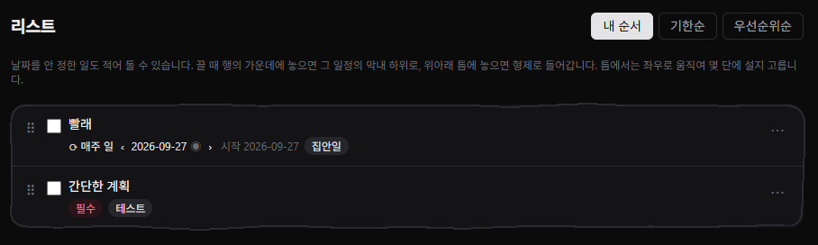
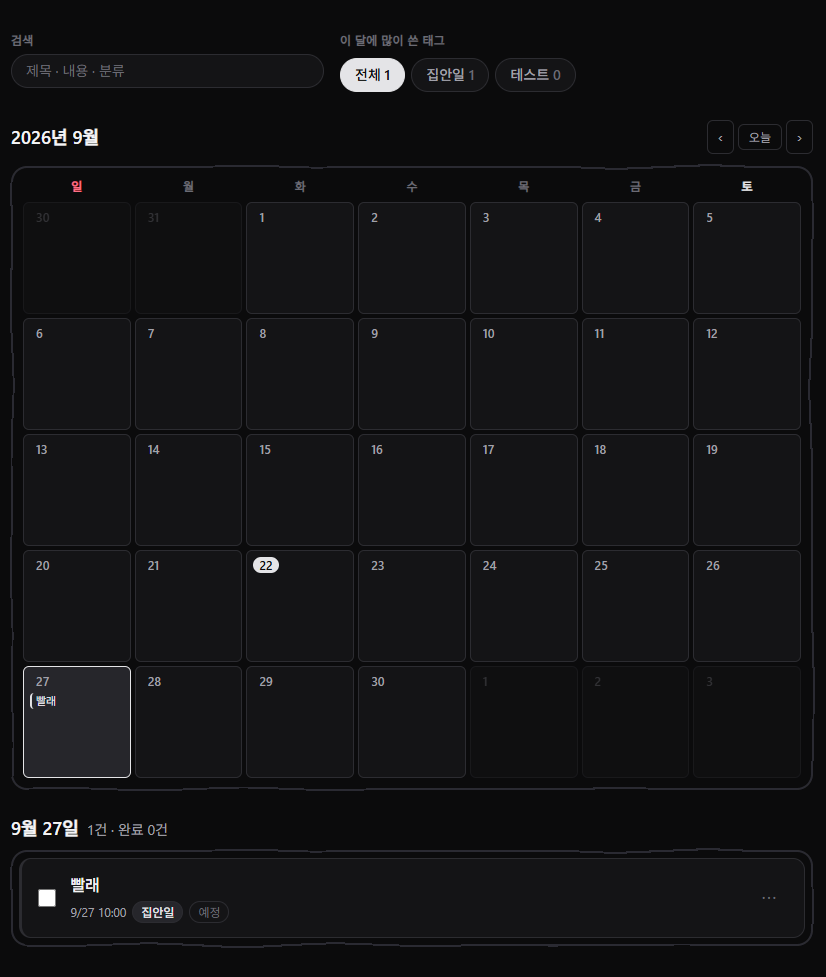
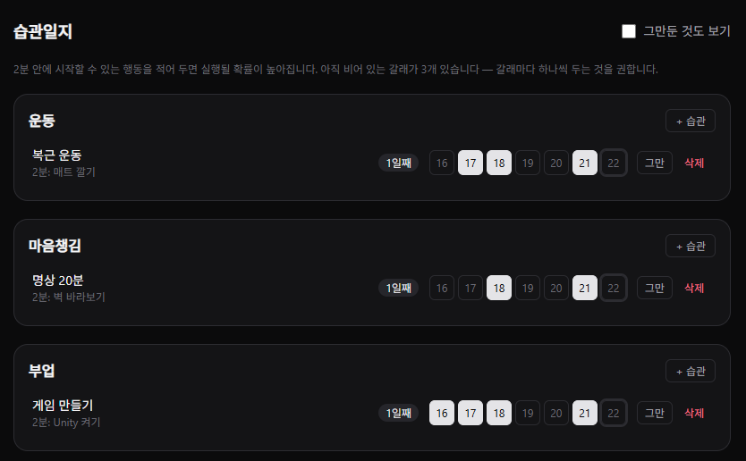
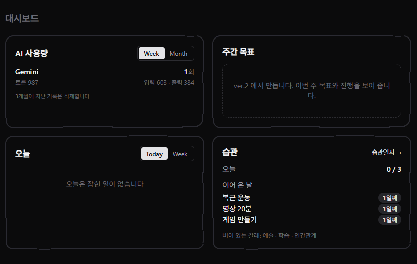
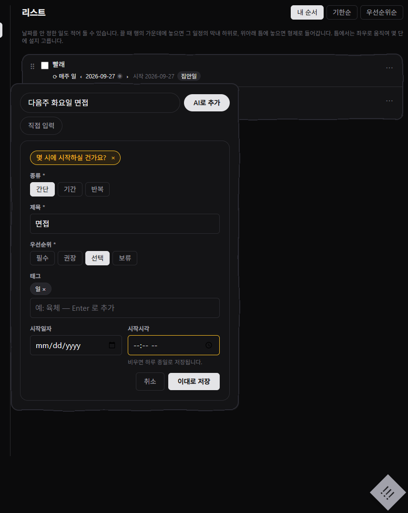
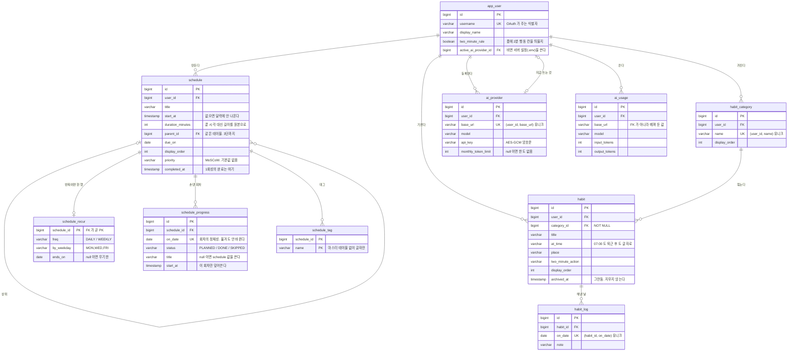

<div align="center">

# LonelyTracker

### 혼자서도 꾸준히. AI 가 받아 적는 일정·습관 기록



**계정도 서버도 없이, clone 해서 내 컴퓨터에서 돌리는 일정 관리 앱입니다.**<br/>
AI 는 설정이라 쓰던 API 키를 그대로 꽂습니다.


> Claude Code 로 작업 중입니다. 개발자도 직접 코드를 수정하고 있지만 중대한 버그가 있을 수 있습니다.

</div>

---

## 목차

|     |                                                                                                                                          |
| --- | ---------------------------------------------------------------------------------------------------------------------------------------- |
| 1   | [프로젝트 개요](#1-프로젝트-개요)                                                                                                        |
| 2   | [설치 및 이용 방법](#2-설치-및-이용-방법) · [프로젝트 설치](#21-프로젝트-설치) · [DB 연결](#22-db-연결) · [AI API 연결](#23-ai-api-연결) |
| 3   | [주요 기능](#3-주요-기능)                                                                                                                |
| 4   | [ERD](#4-erd)                                                                                                                            |
| 5   | [앞으로](#5-앞으로)                                                                                                                      |

---

## 1. 프로젝트 개요

**"언젠가 해야 하는데 언제인지 안 정해진 것"을 달력에 적을 수는 없습니다.**
그래서 일정을 한 벌만 두고, 탭이 그것을 다른 눈으로 보게 만들었습니다. 리스트에 적은 항목에
시각을 채우면 달력에 나타납니다. 행을 옮기지도 복사하지도 않습니다.

습관은 한 걸음 더 갑니다. **2분 법칙**(_Atomic Habits_)과 **실행 의도**(implementation
intention)를 지키려면 시간·장소·2분 행동을 매번 적어야 하는데, 그게 귀찮아서 습관이 되기
전에 그만두게 됩니다. **그 받아쓰기를 AI 에게 맡기는 것이 이 앱의 출발점입니다.**

### 이런 선택을 했습니다

|                              |                                                                            |
| ---------------------------- | -------------------------------------------------------------------------- |
| **계정 없음**                | clone 하면 로그인 없이 바로 돕니다. 아이디·비밀번호를 만들지 않습니다      |
| **AI 는 구현이 아니라 설정** | OpenAI 호환 주소 하나로 전부 받습니다. 제공자를 늘려도 코드는 그대로입니다 |
| **AI 가 바로 저장하지 않음** | 초안으로 보여주고, 고친 다음 저장합니다. 틀렸을 때 되돌릴 일이 없습니다    |
| **키는 내 DB 에만**          | AES-GCM 으로 암호화해 저장하고 응답에 절대 싣지 않습니다                   |

### 기술 스택

| 계층        | 기술                              | 선택 이유                                                    |
| ----------- | --------------------------------- | ------------------------------------------------------------ |
| 백엔드      | Spring Boot 4.1 / Java 21         | 실무에서 쓰는 스택으로 익히려는 목적                         |
| DB          | PostgreSQL 17                     | `generate_series` 등을 마이그레이션에서 실제로 활용          |
| 스키마 관리 | Flyway                            | `ddl-auto` 로는 열 삭제와 데이터 이전이 불가능               |
| 프론트      | React 19 / TypeScript / Vite      | 백엔드 DTO 와 타입을 맞춰 필드명 오타를 컴파일 단계에서 차단 |
| 테스트      | JUnit 5 + Testcontainers / Vitest | 실제 PostgreSQL 컨테이너로 검증                              |

---

## 2. 설치 및 이용 방법

### 빠른 시작

**DB를 [Neon](https://neon.com)에 맡기는 편이 편합니다.** <br/>
설치할 것이 JDK와 Node 뿐이며, 무료 저장공간이 1GB 이상입니다 (26.10.12 기준)

```bash
git clone https://github.com/maruchi1203/LonelyTracker.git
cd LonelyTracker
cp backend/.env.example backend/.env    # DB_PASSWORD 와 DB_URL 을 채웁니다
cd backend
./gradlew bootJar
java -jar build/libs/lonelytracker-1.0.0.jar
```

`http://localhost:8080` 을 엽니다. **첫 화면이 비어 있는 것이 정상입니다.** 일정도 습관도 없는
상태로 시작하고, 습관 카테고리 여섯 개만 미리 들어 있습니다.

AI 기능은 키를 넣기 전까지 잠겨 있습니다 → [2.3 AI API 연결](#23-ai-api-연결)

> **창을 넓게 엽니다.** 최소 폭이 960px이라 그보다 좁으면 가로 스크롤이 생깁니다.
> 폰과 태블릿 대응은 아직 없습니다.

---

### 2.1 프로젝트 설치

| 준비물     | 버전               |                                           |
| ---------- | ------------------ | ----------------------------------------- |
| JDK        | 21                 |                                           |
| Node.js    | 20.19+ 또는 22.12+ | Vite 8 이 21 과 22.0 을 거부합니다        |
| PostgreSQL | 17                 | DB 를 직접 띄울 때만 → [2.2](#22-db-연결) |
| Docker     | —                  | 테스트를 돌릴 때만                        |

#### 2.1.1. jar 하나로 (추천)

```bash
cd backend && ./gradlew bootJar
java -jar build/libs/lonelytracker-1.0.0.jar
```

`bootJar` 가 `npm install` 과 `npm run build` 를 알아서 부르고 결과를 jar 안에 담습니다.
그래서 빌드할 때는 Node 가 필요하고, 만들어진 jar 를 실행할 때는 JDK 만 있으면 됩니다.

> **`backend/` 에서 실행해야 합니다.** `.env` 를 현재 폴더에서 찾습니다. 다른 곳에서 띄우려면
> `DB_PASSWORD` 를 환경 변수로 넘깁니다.

#### 2.1.2 창 두 개로 (개발용)

```bash
cd backend && ./gradlew bootRun

# Window Powershell일 경우
cd frontend; ./gradlew bootRun
```

```bash
cd frontend && npm install && npm run dev

# Window Powershell일 경우
cd frontend; npm install; npm run dev
```

#### 테스트

백엔드 테스트는 **Docker 가 떠 있어야 합니다.** Testcontainers 가 PostgreSQL 컨테이너를
직접 띄워 검증합니다. 프론트는 Docker 없이 돕니다.

```bash
cd backend && ./gradlew test
cd frontend && npm test && npm run lint && npm run build

# Window Powershell일 경우
cd backend; ./gradlew test
cd frontend; npm test; npm run lint; npm run build
```

---

### 2.2 DB 연결

테이블은 Flyway 가 첫 실행 때 전부 구성해줍니다. <br/>

#### 2.2.1 호스팅 DB (설치 없음, 추천)

|                                  | 무료 한도      | 쉬면                                                    |
| -------------------------------- | -------------- | ------------------------------------------------------- |
| [Neon](https://neon.com)         | 프로젝트당 1GB | 5분 뒤 잠들고, 다시 부르면 수백 ms 안에 깹니다          |
| [Supabase](https://supabase.com) | 500MB          | 일주일 안 쓰면 정지되고 대시보드에서 직접 깨워야 합니다 |

혼자 쓰는 일정 데이터로 1GB 를 채우기는 어렵습니다.

**Neon** — 콘솔의 Connect에서 주소를 복사합니다.

```properties
DB_URL=jdbc:postgresql://ep-xxxx.ap-southeast-1.aws.neon.tech/neondb?sslmode=require
DB_USERNAME=neondb_owner
DB_PASSWORD=...
```

> `sslmode=require` 가 없으면 연결을 거부합니다.
> 호스트에 `-pooler` 가 붙은 주소가 아니라 **직결 주소**를 씁니다. 풀러를 거치면 Flyway 가 깨집니다.

**Supabase** — Connect 대화상자의 **Session pooler** 주소를 씁니다.

```properties
DB_URL=jdbc:postgresql://aws-0-ap-northeast-2.pooler.supabase.com:5432/postgres
DB_USERNAME=postgres.프로젝트-ref
DB_PASSWORD=...
```

> 주소가 셋이라 헷갈리는 자리입니다. **`6543` 은 Transaction pooler** 라 prepared statement 를
> 못 써서 Flyway 가 깨집니다. **직결 주소는 IPv6 전용**이라 IPv4 망에서는 아예 닿지 않습니다.
> 둘 사이를 메우는 것이 **`5432` Session pooler** 입니다.

#### 2.2.2 로컬 DB

```sql
CREATE USER lonelytracker WITH PASSWORD '아무거나';
CREATE DATABASE lonelytracker OWNER lonelytracker;
```

`backend/.env` 에 비밀번호만 적으면 됩니다. 주소와 사용자명은 기본값이 이 둘과 같습니다.

```properties
DB_PASSWORD=위에서-정한-비밀번호
```

> `DB_URL` 을 적을 때는 `DB_USERNAME` 도 함께 적습니다. 기본값이 `lonelytracker` 라
> 그대로 두면 인증이 막힙니다.

---

### 2.3 AI API 연결

자연어 입력을 쓰려면 AI 제공자의 키가 필요합니다. 길이 둘인데 **설정 화면에서 고른 것이 `.env` 보다 먼저입니다.**

|                  | 언제                                                  |
| ---------------- | ----------------------------------------------------- |
| `.env` 에 적기   | clone 해서 혼자 쓰고, 제공자 하나로 고정할 때         |
| 설정 화면에 넣기 | 제공자를 오가며 쓸 때. 키를 DB 에 암호화해 저장합니다 |

```properties
AI_BASE_URL=https://generativelanguage.googleapis.com/v1beta/openai
AI_MODEL=gemini-2.5-flash
AI_API_KEY=발급받은-키
```

> **따옴표를 붙이지 않습니다.** properties 로 읽혀 따옴표가 값에 들어갑니다.

| 제공자 | `AI_BASE_URL`                                             | `AI_MODEL` 예               |
| ------ | --------------------------------------------------------- | --------------------------- |
| OpenAI | `https://api.openai.com/v1`                               | `gpt-5.6-luna`              |
| Gemini | `https://generativelanguage.googleapis.com/v1beta/openai` | `gemini-2.5-flash`          |
| Claude | `https://api.anthropic.com/v1`                            | `claude-haiku-4-5-20251001` |

OpenAI 호환 주소면 목록에 없는 제공자도 씁니다. Claude 는 주소를 보고 네이티브 규약으로 자동 전환됩니다.

설정 화면에 키를 저장하려면 `backend/.env` 에 마스터 키가 하나 더 필요합니다.

```properties
LONELYTRACKER_ENCRYPTION_KEY=아무-긴-문자열
```

길이는 자유입니다. SHA-256 으로 256비트 키를 만듭니다. 없어도 앱은 뜨지만 키 저장만 막힙니다.
**한 번 정하면 바꾸지 않습니다.** 바꾸면 저장해 둔 키를 읽지 못합니다.

---

## 3. 주요 기능

**"다음 주 화요일 저녁 7시에 헬스장, 끝나고 장보기"** 한 줄이 일정 두 개가 됩니다.

|                            |                                                              |
| -------------------------- | ------------------------------------------------------------ |
| 여러 개를 뽑습니다         | 한 문장에 일정이 둘이면 둘 다 만듭니다                       |
| 모자라면 되묻습니다        | 시간이 없으면 "언제로 할까요"를 띄웁니다                     |
| **바로 저장하지 않습니다** | 초안으로 보여주고, 고친 다음 저장합니다                      |
| 못 읽으면 넘깁니다         | 오류가 아니라 직접 입력칸으로 보냅니다 (사용량은 책정됩니다) |

### 리스트

<p align="center">
  
  <br />
  <sub>간단한 메모도 일정처럼 적어 둘 수 있습니다</sub>
</p>

- **3단 계층** — 끌어서 하위로 넣거나 형제로 빼냅니다. 틈에서 좌우로 움직여 몇 단에 설지 고릅니다
- **MoSCoW 우선순위** — 필수 · 권장 · 선택 · 보류. 값을 정하지 않은 것과 "선택"으로 정한 것을 구분합니다
- **여러 정렬** — 내 순서 · 기한순 · 우선순위순. 보기만 바뀌고 저장한 순서는 그대로입니다
- **완료가 아래로 번짐** — 부모를 끝내면 자손도 함께 끝납니다

### 달력

<p align="center">
  
  <br />
  <sub>월간 격자와 그 날의 목록을 함께 봅니다</sub>
</p>

- **반복 일정** — 매일, 또는 매주 요일마다 반복합니다
- **회차 옮김·건너뜀** — 한 회차만 다른 날로 옮기거나 건너뜁니다. 옮긴 회차에는 `↻ 옮김`이 붙습니다
- **태그** — 태그와 키워드로 찾습니다
- **리스트와 한 벌** — 같은 데이터입니다. 다만 우선순위 등은 표시되지 않습니다

### 습관일지

<p align="center">
  
  <br />
  <sub>달력이 "수행할 일정"을 보여준다면, 습관 탭은 "행동 기록"을 보여줍니다</sub>
</p>

- **카테고리** — 운동 · 마음챙김 · 부업 · 예술 · 학습 · 인간관계로 시작합니다. 고치고, 지우고, 새로 만들고, 순서를 바꿉니다
- **연속일** — 며칠째 이어 왔는지 셉니다
- **그만두기** — 쌓인 기록을 지우지 않고 습관만 접어 둡니다. 언제든 다시 켭니다
- **2분 법칙** — 아래 네 칸으로 실행 의도를 적습니다

| 칸        | 내용                                                                             |
| --------- | -------------------------------------------------------------------------------- |
| 목표      | 이루고 싶은 것                                                                   |
| 행동      | 목표 달성을 위해 해야 할 구체적 행동                                             |
| 시간/장소 | 언제, 어디서 (구체적일수록 좋습니다)                                             |
| 2분 행동  | 시작에 필요한 2분 이내 미니 행동 (`"헬스장 가기"` → `"퇴근 후 운동복 갈아입기"`) |

### 대시보드

<p align="center">
  
  <br />
  <sub>오늘의 필수 · 권장 · 마감, 습관, 주간 목표, AI 사용량을 모아 봅니다</sub>
</p>

### 빠른 추가

<p align="center">
  
  <br />
  <sub>어느 탭에서든 우하단 버튼으로 엽니다</sub>
</p>

한 줄로 적거나, 칸을 채워 적습니다. 탭을 옮겨 다니지 않아도 됩니다.
AI 가 뽑아 둔 초안은 창을 닫거나 새로 고쳐도 남습니다. 저장하거나 버릴 때까지 그대로입니다.

### 설정

| 항목          | 내용                                                                            |
| ------------- | ------------------------------------------------------------------------------- |
| AI 제공자     | 주소 · 모델 · 키를 등록하고 쓸 것을 고릅니다. 제공자마다 월 토큰 한도를 둡니다  |
| 2분 법칙      | 끄면 습관일지에서 시간 · 장소 · 2분 행동 칸이 내려갑니다. 적어 둔 값은 남습니다 |
| 습관 카테고리 | 만들고, 이름을 고치고, 지우고, 순서를 바꿉니다. 마지막 하나는 지울 수 없습니다  |

월 토큰 한도를 넘기면 AI 를 부르지 않고 안내만 돌려줍니다. 쓴 양은 대시보드에서 봅니다.

---

## 4. ERD

테이블 10개입니다. 마이그레이션은 `backend/src/main/resources/db/migration/` 의 `V1`~`V3` 입니다.



---

## 5. 앞으로

> 목표는 개발 중간에 조금씩 바뀔 수 있습니다.

| 버전        | 한 줄                        | 무엇이 달라지나                                       | 상태          |
| ----------- | ---------------------------- | ----------------------------------------------------- | ------------- |
| **Ver.1**   | 계정 없이 clone 해서 쓰는 앱 | 일정·습관·AI 입력이 한 벌로 돕니다                    | 🔶 마무리 중  |
| **Ver.1.1** | 편의 기능                    | 프로젝트 · 테마 · 알림 · 좁은 화면                    | ⬜ 예정       |
| **Ver.1.2** | 기능 전반을 AI 로 관리       | 입력뿐 아니라 관리까지 맡깁니다                       | ⭐ **최중요** |
| **Ver.1.3** | 외부 앱 연동                 | 이메일 · 구글 캘린더                                  | ⬜ 예정       |
| **Ver.1.4** | 로그인과 구독제              | 키도 DB 도 없이 쓰게 합니다. clone 은 계속 무료입니다 | ❔ 미정       |

🔶 진행 중 · ⭐ 가장 중요 · ⬜ 예정 · ❔ 할지 미정

### Ver.1 에서 남은 것

기능은 거의 다 됐습니다. 남은 것은 디자인, 로직 다듬기, 일부 버그 수정입니다.

|                     |                                                |
| ------------------- | ---------------------------------------------- |
| 디자인 세부 조정    | 🔶 진행 중                                     |
| 달력 주간·연간 보기 | ver.1 범위 밖. 월간 격자 하나로 보여줍니다     |
| 좁은 화면           | 최소 폭 960px. ver.1.1 에서 테마와 함께 봅니다 |

### Ver.1.1 — 편의 기능

| 항목                 | 내용                                                                         |
| -------------------- | ---------------------------------------------------------------------------- |
| 프로젝트 탭          | 일정 위에 얹는 상위 단위입니다. 메뉴에 자리는 잡아 뒀고 화면만 비어 있습니다 |
| 주간 목표            | 이번 주 목표와 진행을 보여줍니다. 대시보드에 칸은 서 있고 내용이 없습니다    |
| 테마                 | 밝은 화면과 어두운 화면을 고릅니다. 고른 값은 브라우저가 기억합니다          |
| 좁은 화면            | 폰과 태블릿에서 접히게 만듭니다                                              |
| 알림                 | 마감과 2분 행동을 제때 알려줍니다                                            |
| 달력 주간·연간 보기  | ver.1 에서 미뤄 둔 것입니다                                                  |
| 습관별 건너뛰기 규칙 | "주말은 세지 않기" 처럼 습관마다 다른 규칙을 둡니다                          |

### Ver.1.2 — 기능 전반을 AI 로 (최중요)

| 항목               | 내용                                                                            |
| ------------------ | ------------------------------------------------------------------------------- |
| 말로 고치고 지우기 | 지금은 추가만 AI 가 맡습니다. 수정과 삭제까지 넓힙니다                          |
| AI 코칭            | 2분 법칙에 맞게 계획을 다듬어 줍니다. 거창해진 계획을 잘라 주는 쪽이 핵심입니다 |
| 주간 리포트        | 한 주를 돌아보는 요약을 만듭니다                                                |
| 실패 이유 알려주기 | 못 읽었을 때 왜 못 읽었는지 알려줍니다. 지금은 "직접 입력해 주세요" 뿐입니다    |
| 사용량을 돈으로    | 토큰 수 대신 대략의 금액으로 보여줍니다                                         |

### Ver.1.3 — 외부 앱 연동

바깥과 데이터를 주고받기 시작하는 시점이라, 시간대처럼 미뤄 둔 데이터 문제도 여기서 함께 정리합니다.

| 항목          | 내용                                                                          |
| ------------- | ----------------------------------------------------------------------------- |
| 구글 캘린더   | 먼저 읽어 오는 것부터 시작합니다. 양방향은 그다음입니다                       |
| 이메일        | 메일 내용에서 일정을 뽑아냅니다. 자연어 파싱이 이미 있어 입구만 늘리면 됩니다 |
| 내보내기      | 다른 앱으로 옮겨 갈 수 있게 내보냅니다                                        |
| 사용자 시간대 | 지금은 띄운 컴퓨터의 시간을 그대로 씁니다. 외부 달력과 시각을 맞춥니다        |

### Ver.1.4 — 로그인과 구독제 (고민 중)

clone 해서 쓰는 방법은 그대로 둡니다. 구독하면 키를 발급받거나 DB 를 띄우지 않아도 바로 쓸 수 있게 합니다.

| 순서 | 목표          | 내용                                                               |
| ---- | ------------- | ------------------------------------------------------------------ |
| 1    | OAuth 로그인  | 구글 OAuth + 세션 쿠키. 자체 호스팅은 무인증 모드 유지             |
| 2    | 배포 · 구독제 | API·DB 를 서버가 대신 줍니다. clone 은 계속 무료입니다             |
| 3    | 결제          | AI·DB 사용량에 맞춰 받습니다. 자체 호스팅은 계속 무인증 무료입니다 |

### `java -jar` 한 줄로

프론트는 jar 안에 들어갔습니다. 남은 것은 PostgreSQL 내장입니다. 그때까지는 DB 를 따로 띄워야 합니다.

---

<div align="center">

**만들며 내린 결정과 시행착오** — [작업 노트](https://dented-polyanthus-255.notion.site/LonelyTracker-2fc432d8688b80c29209dd2f1d10638a)

</div>
